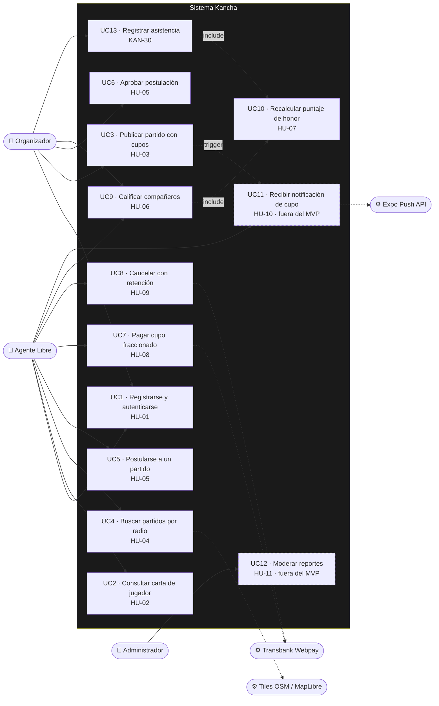
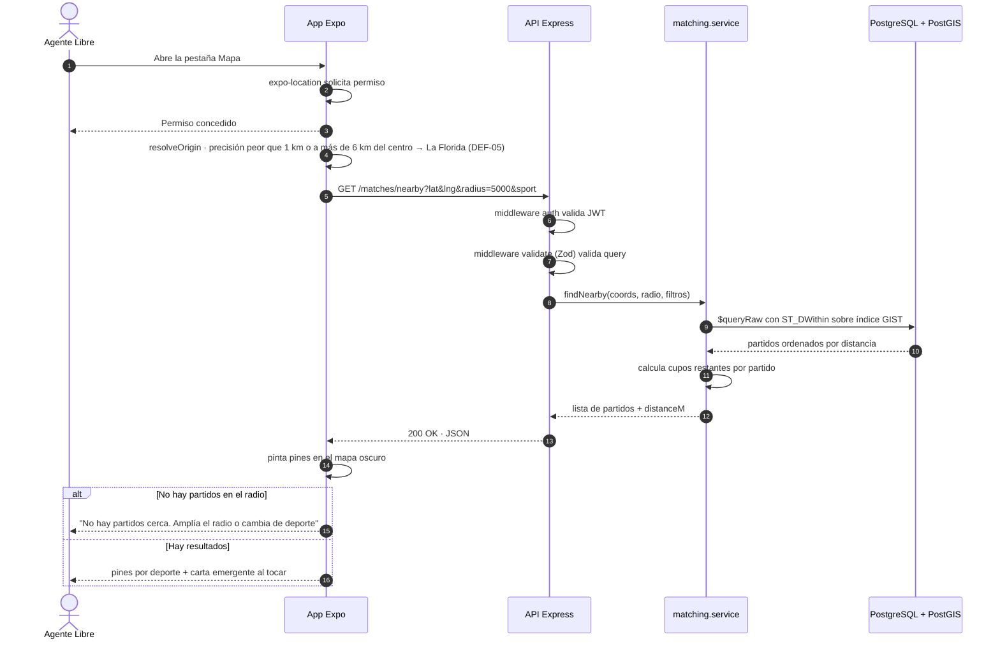
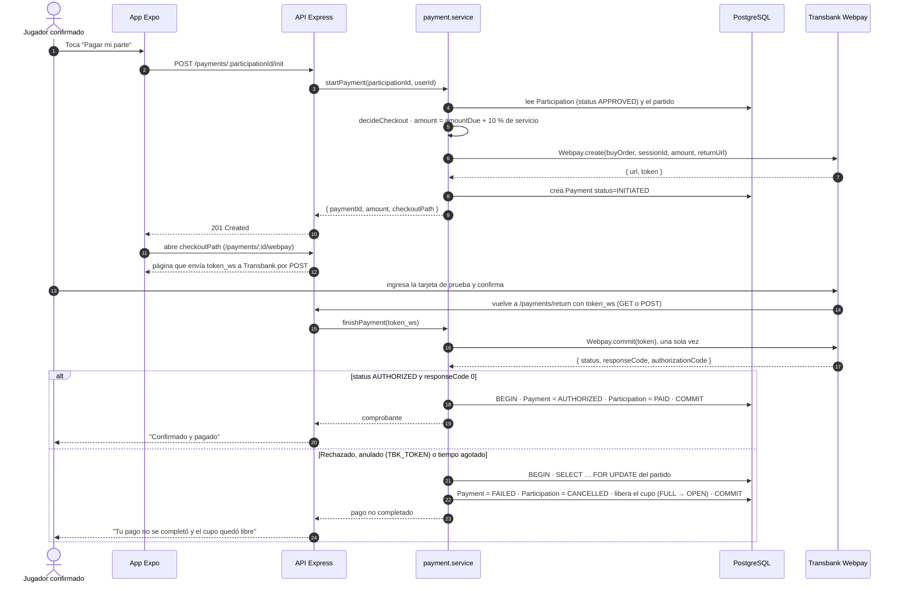
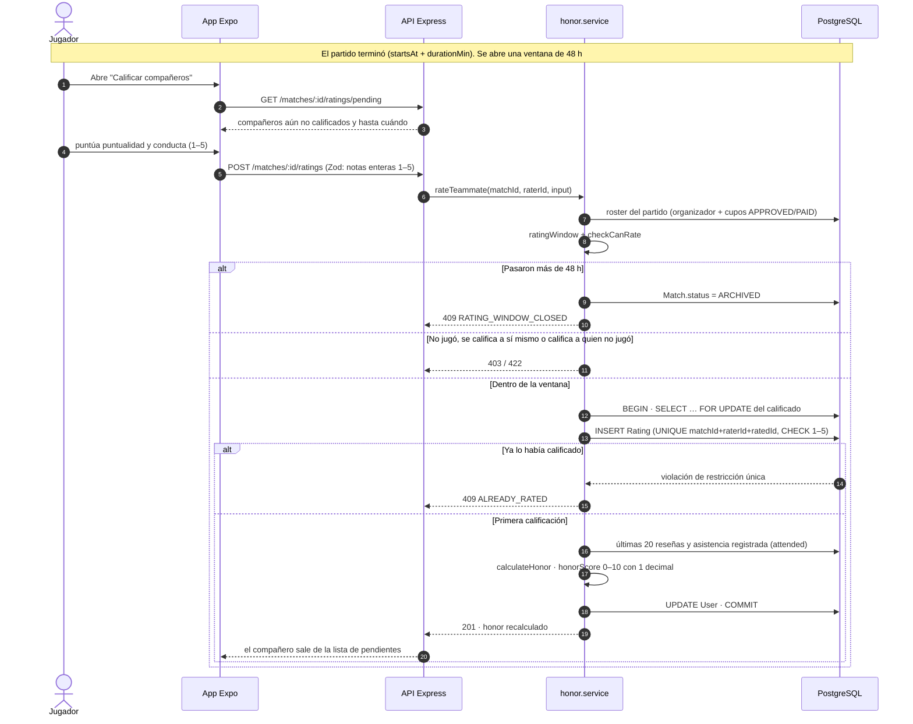
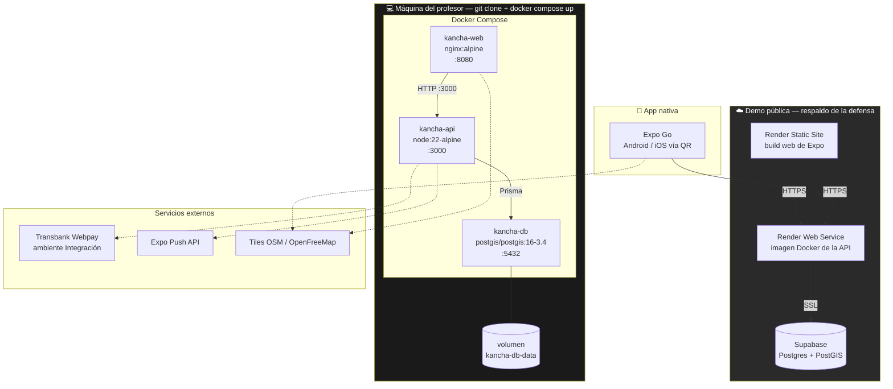
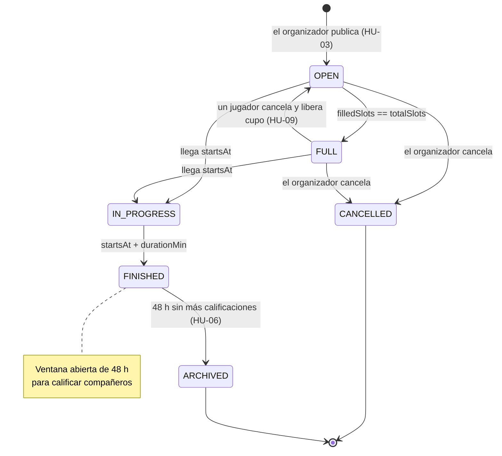
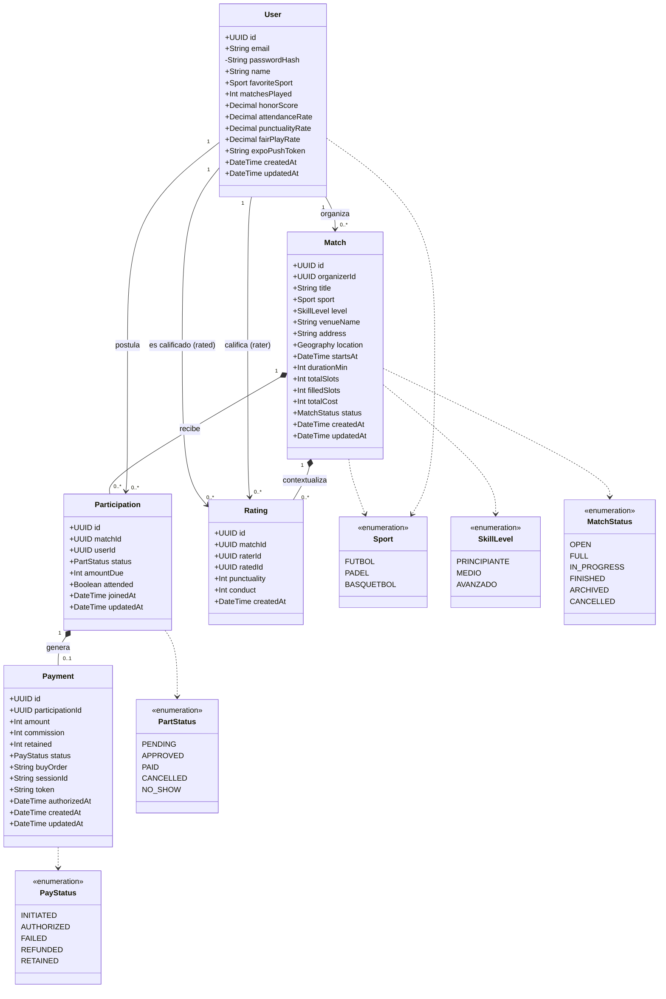
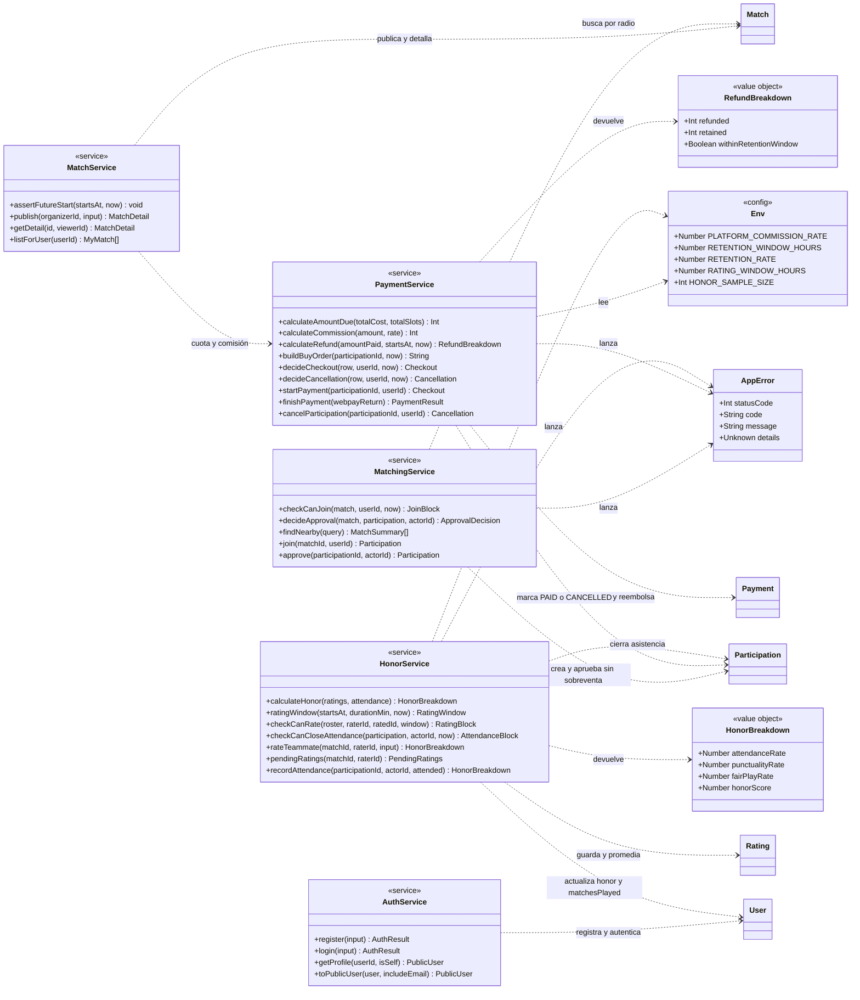

# Diagramas UML — Kancha

> Entregable del Sprint 3 (01–14 sep 2026) · Issue **KAN-22** · Evidencia de las competencias **C3** y **C4**
> Los diagramas están en Mermaid: GitHub los renderiza directamente en el navegador, así que el
> profesor los ve sin descargar nada ni abrir herramientas externas.

---

## 1. Diagrama de Casos de Uso

**Lectura:** los casos de uso con línea continua forman el MVP entregado (HU-01 a HU-09, más el
registro de asistencia de KAN-30, que también recalcula el honor). UC11 y UC12 aparecen punteados:
HU-10 salió del alcance el 8 de noviembre de 2026 y HU-11 está marcada `Won't have this phase`; ambas
viven en el backlog.
Las flechas punteadas hacia la derecha marcan la dependencia de sistemas externos.

---

## 2. Secuencia — Búsqueda geolocalizada (HU-04)

Es la consulta central del producto y la evidencia principal de la competencia C3.

---

## 3. Secuencia — Pago fraccionado (HU-08)

Flujo crítico del modelo de negocio. Involucra un sistema externo y debe ser transaccional.

---

## 4. Secuencia — Calificación y recálculo de honor (HU-06 + HU-07)

---

## 5. Diagrama de Despliegue

> La versión detallada de este diagrama, junto con el **diagrama de componentes**, está en
> [`03-arquitectura.md`](03-arquitectura.md).

**Lectura:** el bloque de la izquierda es el plan A de la defensa — todo corre en la máquina del
profesor con un solo comando, sin depender de internet. El bloque de la nube es el respaldo, y la
app nativa se demuestra por QR sobre la misma API desplegada.

---

## 6. Diagrama de estados — Ciclo de vida de un partido

**Cómo se implementó:** `OPEN`, `FULL` y `ARCHIVED` se guardan en la base. `IN_PROGRESS` y
`FINISHED` no se escriben: dependen solo de la hora, así que la API los calcula en cada consulta
(`ratingWindow` devuelve `NOT_FINISHED`, `OPEN` o `CLOSED`) y no hace falta una tarea programada que
cambie estados. `ARCHIVED` se guarda la primera vez que alguien intenta calificar o abre los
pendientes después de las 48 h. La cancelación del partido por el organizador no entró en el MVP.

---

## 7. Diagrama de clases — Modelo de dominio

Las cinco entidades del sistema con sus atributos, tipos y multiplicidades. Corresponde uno a uno
con `backend/prisma/schema.prisma`.

**Lectura:** el rombo relleno es composición: una participación, una reseña o un pago no existen sin
su partido o su participación, y se borran con ellos (`ON DELETE CASCADE`). La flecha simple es
asociación: el usuario sobrevive aunque se borre el partido. `honorScore` y las tres tasas de `User`
admiten valor nulo, que la interfaz muestra como "Sin calificaciones aún".

---

## 8. Diagrama de clases — Servicios de negocio

Las operaciones del sistema viven en la capa de servicios, no en las entidades. Cada servicio es un
módulo de funciones puras: recibe datos, devuelve un resultado y no guarda estado.

**Lectura:** todas las operaciones existen en `backend/src/services/`, un archivo `*.service.ts` por
servicio. Las que empiezan con `calculate`, `check`, `decide`, `build` o `assert` son funciones puras y
se prueban sin base de datos (76 pruebas unitarias). Las demás orquestan el acceso a datos a través de
`repositories/` y se prueban contra PostGIS real (62 pruebas de integración).
`Env` reúne los parámetros de negocio configurables, para que cambiar la comisión o la ventana de
retención no exija tocar código.

---

*Kancha · Portafolio de Título · Lukas Guerrero · Sprint 3, septiembre 2026 · actualizado el 8 de noviembre de 2026*
