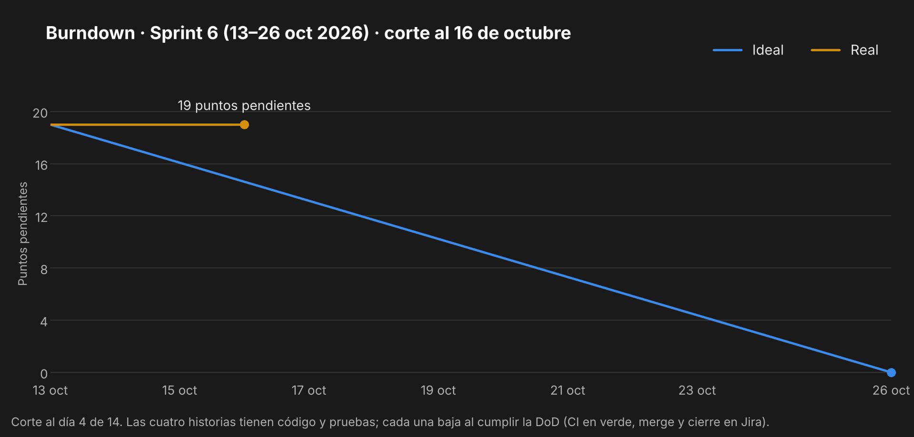

# Sprint 6 — Recorrido central: registro, publicación, mapa y postulación

> 13 al 26 de octubre de 2026 · Fase 2 · **Sprint en curso**
> Corte de este documento: 16 de octubre de 2026 (día 4 de 14).

---

## 1. Sprint Planning

**Objetivo del sprint.** Que el recorrido central de la demo funcione de punta a punta: un agente libre
se registra, ve en el mapa los partidos con cupo cerca, postula a uno y el organizador lo aprueba; un
organizador publica un partido al que le falta gente.

| Dato | Valor |
|---|---|
| Duración | 14 días (13 – 26 de octubre) |
| Equipo | Lukas Guerrero, desarrollador único |
| Compromiso | 19 puntos de historia (HU-01 y HU-03 arrastradas del Sprint 5, más HU-04 y HU-05) y KAN-23 |

## 2. Sprint Backlog

| Issue | Tipo | Título | Prioridad | Puntos | Estado al 16-oct |
|---|---|---|---|---|---|
| [KAN-7](https://lukasguerrerokancha.atlassian.net/browse/KAN-7) | Historia | HU-01 — Registro de agente libre | Must | 3 | Código y pruebas listos · falta merge |
| [KAN-9](https://lukasguerrerokancha.atlassian.net/browse/KAN-9) | Historia | HU-03 — Publicar partido con cupos incompletos | Must | 5 | Código y pruebas listos · falta merge |
| [KAN-10](https://lukasguerrerokancha.atlassian.net/browse/KAN-10) | Historia | HU-04 — Buscar partidos cercanos en el mapa | Must | 8 | Código y pruebas listos · falta merge |
| [KAN-11](https://lukasguerrerokancha.atlassian.net/browse/KAN-11) | Historia | HU-05 — Postularme a un partido | Must | 3 | Código y pruebas listos · falta merge y notificación |
| [KAN-23](https://lukasguerrerokancha.atlassian.net/browse/KAN-23) | Tarea | Documentación de la Fase 2 | — | — | En curso |

Desglose técnico:

| Historia | Backend | App |
|---|---|---|
| HU-01 | `POST /auth/register`, `POST /auth/login`, `GET /users/me` · bcrypt costo 12 · JWT · honor `null` | Pantallas de entrada y registro con disciplina favorita · sesión persistente · perfil con "Sin calificaciones aún" |
| HU-03 | `POST /matches` con ubicación PostGIS · rechazo de fechas pasadas (422) | Formulario de publicación: deporte, nivel, cancha, punto en el mapa, día, hora, cupos y arriendo |
| HU-04 | `GET /matches/nearby` con `ST_DWithin` sobre el índice GIST, filtros de deporte, nivel y horario | Mapa oscuro (MapLibre en web, react-native-maps en móvil), pines por deporte, filtros, radio de 2, 5 o 10 km, carrusel o panel de cartas |
| HU-05 | `POST /matches/:id/join` (pendiente) y `PATCH /participations/:id/approve` con `SELECT … FOR UPDATE` | Detalle del partido con el botón "Falta 1", estados pendiente y confirmado, aprobación por el organizador, "Mis partidos" |

## 3. Scrumboard

Estado del tablero al 16 de octubre:

| Por hacer | En curso | Listo |
|---|---|---|
| — | KAN-7 · HU-01 | — |
| | KAN-9 · HU-03 | |
| | KAN-10 · HU-04 | |
| | KAN-11 · HU-05 | |
| | KAN-23 · Documentación Fase 2 | |

Una historia pasa a *Listo* cuando cumple la Definición de Terminado (`DESARROLLO.md` §13): CI en
verde en el Pull Request, merge a `develop` y evidencia en `docs/evidencias/`.

## 4. Burndown Chart

Al día 4 la línea real sigue en 19 puntos: el código de las cuatro historias existe y sus pruebas
pasan, pero ninguna cumple todavía la DoD.

## 5. Daily Meeting

| Fecha | Qué hice | Qué haré | Impedimentos |
|---|---|---|---|
| 13–15 oct | Sin avance en el proyecto | — | Carga laboral de la práctica (IMP-09) |
| 16 oct | Replanificación en Jira (HU-01, HU-03 y KAN-23 al Sprint 6). Backend de HU-01, HU-03, HU-04 y HU-05 con 90 pruebas (61 unitarias y 29 de integración contra PostGIS). Swagger en `/api/docs`. App: diseño propio sobre `DESIGN.md`, entrada, registro, mapa, detalle, publicación, mis partidos y perfil. 13 pruebas de componentes | Commit por historia, Pull Request a `develop`, CI en verde. Probar la app en el celular con Expo Go | Los sprints de Jira siguen sin iniciarse (IMP-01) |

## 6. Registro de impedimentos

| ID | Impedimento | Efecto | Estado |
|---|---|---|---|
| IMP-09 | Carga laboral de la práctica profesional | Tres días del sprint sin avance | Abierto |
| IMP-01 | El Sprint 2 sigue activo en Jira y los sprints 3 a 6 nunca se iniciaron | Sin burndown automático de Jira; los gráficos se generan a mano | Abierto: cerrar los sprints desde el tablero |
| IMP-10 | Windows protege la carpeta `.github/` frente a las herramientas de escritura remota | Los cambios al CI se hacen a mano | Abierto |

## 7. Release

Pendiente. Al cierre del sprint se publica `v0.6.0 — Sprint 6: registro, publicación, mapa y postulación`.

## 8. Sprint Review

Se completa al cierre del sprint, el 26 de octubre.

## 9. Sprint Retrospective

Se completa al cierre del sprint, el 26 de octubre.

---

*Kancha · Portafolio de Título · Lukas Guerrero*
