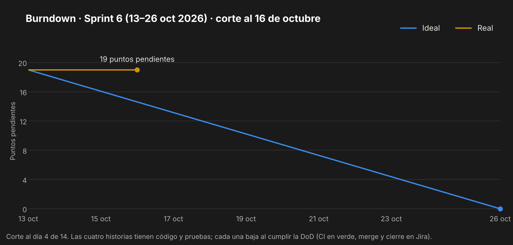
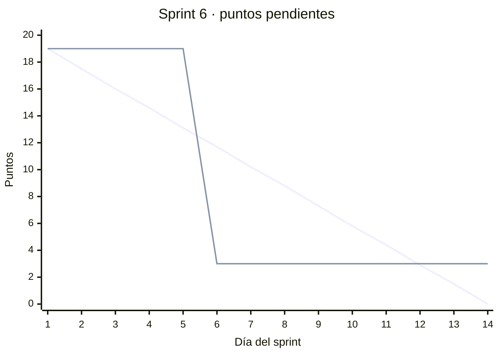

# Sprint 6 — Recorrido central: registro, publicación, mapa y postulación

> 13 al 26 de octubre de 2026 · Fase 2 · **Sprint cerrado**
> Documento abierto el 18 de octubre (día 6 de 14) y cerrado el 8 de noviembre de 2026. Las
> secciones 7 a 9 se completaron ese día con la evidencia disponible (Jira, historial de commits y
> Pull Requests), igual que se hizo con los sprints 3 y 4.

---

## 1. Sprint Planning

**Objetivo del sprint.** Que el recorrido central de la demo funcione de punta a punta: un agente libre
se registra, ve en el mapa los partidos con cupo cerca, postula a uno y el organizador lo aprueba; un
organizador publica un partido al que le falta gente.

| Dato | Valor |
|---|---|
| Duración | 14 días (13 – 26 de octubre) |
| Equipo | Lukas Guerrero, desarrollador único |
| Compromiso | 19 puntos de historia (HU-01 y HU-03 arrastradas del Sprint 5, más HU-04 y HU-05) y KAN-23 |

## 2. Sprint Backlog

| Issue | Tipo | Título | Prioridad | Puntos | Estado al cierre (26-oct) |
|---|---|---|---|---|---|
| [KAN-7](https://lukasguerrerokancha.atlassian.net/browse/KAN-7) | Historia | HU-01 — Registro de agente libre | Must | 3 | Listo · PR #3 a `develop` con CI en verde |
| [KAN-9](https://lukasguerrerokancha.atlassian.net/browse/KAN-9) | Historia | HU-03 — Publicar partido con cupos incompletos | Must | 5 | Listo · PR #3 a `develop` con CI en verde |
| [KAN-10](https://lukasguerrerokancha.atlassian.net/browse/KAN-10) | Historia | HU-04 — Buscar partidos cercanos en el mapa | Must | 8 | Listo · PR #3 a `develop` con CI en verde |
| [KAN-11](https://lukasguerrerokancha.atlassian.net/browse/KAN-11) | Historia | HU-05 — Postularme a un partido | Must | 3 | En curso · código y pruebas en `develop`; el criterio de notificar al organizador dependía de HU-10. Se cerró el 5 de noviembre (Sprint 7) |
| [KAN-23](https://lukasguerrerokancha.atlassian.net/browse/KAN-23) | Tarea | Documentación de la Fase 2 | — | — | En curso · sigue en el Sprint 7 |

Desglose técnico:

| Historia | Backend | App |
|---|---|---|
| HU-01 | `POST /auth/register`, `POST /auth/login`, `GET /users/me` · bcrypt costo 12 · JWT · honor `null` | Pantallas de entrada y registro con disciplina favorita · sesión persistente · perfil con "Sin calificaciones aún" |
| HU-03 | `POST /matches` con ubicación PostGIS · rechazo de fechas pasadas (422) | Formulario de publicación: deporte, nivel, cancha, punto en el mapa, día, hora, cupos y arriendo |
| HU-04 | `GET /matches/nearby` con `ST_DWithin` sobre el índice GIST, filtros de deporte, nivel y horario | Mapa oscuro (MapLibre en web, react-native-maps en móvil), pines por deporte, filtros, radio de 2, 5 o 10 km, carrusel o panel de cartas |
| HU-05 | `POST /matches/:id/join` (pendiente) y `PATCH /participations/:id/approve` con `SELECT … FOR UPDATE` | Detalle del partido con el botón "Falta 1", estados pendiente y confirmado, aprobación por el organizador, "Mis partidos" |

## 3. Scrumboard

Estado del tablero al cierre, el 26 de octubre:

| Por hacer | En curso | Listo |
|---|---|---|
| — | KAN-11 · HU-05 | KAN-7 · HU-01 |
| | KAN-23 · Documentación Fase 2 | KAN-9 · HU-03 |
| | | KAN-10 · HU-04 |

Una historia pasa a *Listo* cuando cumple la Definición de Terminado (`DESARROLLO.md` §13): CI en
verde en el Pull Request, merge a `develop` y evidencia en `docs/evidencias/`.

## 4. Burndown Chart

Corte del día 6 (18 de octubre), generado ese día:

Burndown completo del sprint, puntos pendientes por día:

La primera línea es el ideal y la segunda el real. El día 6 (18 de octubre) HU-01, HU-03 y HU-04
cumplieron la DoD con el merge del PR #3. La línea quedó en 3 puntos hasta el cierre: HU-05 tenía el
código y las pruebas en `develop`, pero su criterio de notificar al organizador dependía de HU-10.

## 5. Daily Meeting

| Fecha | Qué hice | Qué haré | Impedimentos |
|---|---|---|---|
| 13–15 oct | Sin avance en el proyecto | — | Carga laboral de la práctica (IMP-09) |
| 16 oct | Replanificación en Jira (HU-01, HU-03 y KAN-23 al Sprint 6). Backend de HU-01, HU-03, HU-04 y HU-05 con 90 pruebas (61 unitarias y 29 de integración contra PostGIS). Swagger en `/api/docs`. App: diseño propio sobre `DESIGN.md`, entrada, registro, mapa, detalle, publicación, mis partidos y perfil. 13 pruebas de componentes | Commit por historia, Pull Request a `develop`, CI en verde. Probar la app en el celular con Expo Go | Los sprints de Jira siguen sin iniciarse (IMP-01) |
| 18 oct | Commit por historia y PR #3 a `develop`: CI en verde y merge. KAN-7, KAN-9 y KAN-10 a *Listo*. Lanzadores de doble clic para Windows (`iniciar-kancha.bat`, `detener-kancha.bat`) y guía para ver y probar la app | Merge a `main`. Ensayar la demo. Decidir cómo se cierra la notificación de HU-05 | La notificación de HU-05 depende de HU-10, planificada para el Sprint 9 |
| 19 oct | PR #4 de `develop` a `main` y PR #5 con los lanzadores y el estado del sprint | — | — |
| 20–26 oct | Sin avance registrado en el repositorio ni en Jira | — | IMP-09 |

## 6. Registro de impedimentos

| ID | Impedimento | Efecto | Estado |
|---|---|---|---|
| IMP-09 | Carga laboral de la práctica profesional | Diez de los catorce días del sprint sin avance registrado | Abierto |
| IMP-01 | El Sprint 2 sigue activo en Jira y los sprints 3 a 6 nunca se iniciaron | Sin burndown automático de Jira; los gráficos se generan a mano | Abierto: cerrar los sprints desde el tablero |
| IMP-10 | Windows protege la carpeta `.github/` frente a las herramientas de escritura remota | Los cambios al CI se hacen a mano | Abierto |

## 7. Release

El incremento llegó a `main` con el PR #4 el 19 de octubre, con el CI en verde: registro, publicación,
búsqueda por radio en el mapa y postulación con aprobación. El tag `v0.6.0` no se publicó; queda
pendiente en `DESARROLLO.md` §7.6.

## 8. Sprint Review

| Comprometido | Resultado |
|---|---|
| HU-01 — Registro de agente libre (3 pts) | Terminada |
| HU-03 — Publicar partido (5 pts) | Terminada |
| HU-04 — Buscar partidos cercanos en el mapa (8 pts) | Terminada |
| HU-05 — Postularme a un partido (3 pts) | No cerrada en el sprint. Se cerró el 5 de noviembre, al confirmar que la notificación al organizador pertenece a HU-10 |
| KAN-23 — Documentación de la Fase 2 | Avanzada: plan de pruebas con resultados reales, evidencias y documentos de sprint |

**Velocidad del sprint: 16 de 19 puntos.** Es el primer sprint con incremento de producto. El
recorrido se mostró después en una clase presencial: ahí apareció el defecto del mapa registrado
como DEF-05 en el plan de pruebas, que se corrigió en el Sprint 7.

## 9. Sprint Retrospective

| Qué funcionó | Qué no funcionó | Acción |
|---|---|---|
| Entregar cada historia completa (API, pantalla y pruebas) dejó el recorrido central funcionando y probado | El avance se concentró en dos días (16 y 18 de octubre); el resto del sprint no tuvo avance registrado | Planificar menos puntos por sprint mientras dure la práctica y cerrar historias apenas cumplan la DoD |
| El CI con PostGIS real detectó problemas antes del merge (DEF-04) | HU-05 quedó abierta porque uno de sus criterios dependía de otra historia | Revisar en la planificación que cada criterio de aceptación se pueda cumplir dentro de su propia historia |
| La guía para ver la app en el celular y los lanzadores bajaron la barrera para probarla | No se publicó el tag del release ni se cerraron los sprints en Jira (IMP-01) | Publicar el tag al llevar `develop` a `main` y cerrar los sprints en Jira |

---

*Kancha · Portafolio de Título · Lukas Guerrero*
