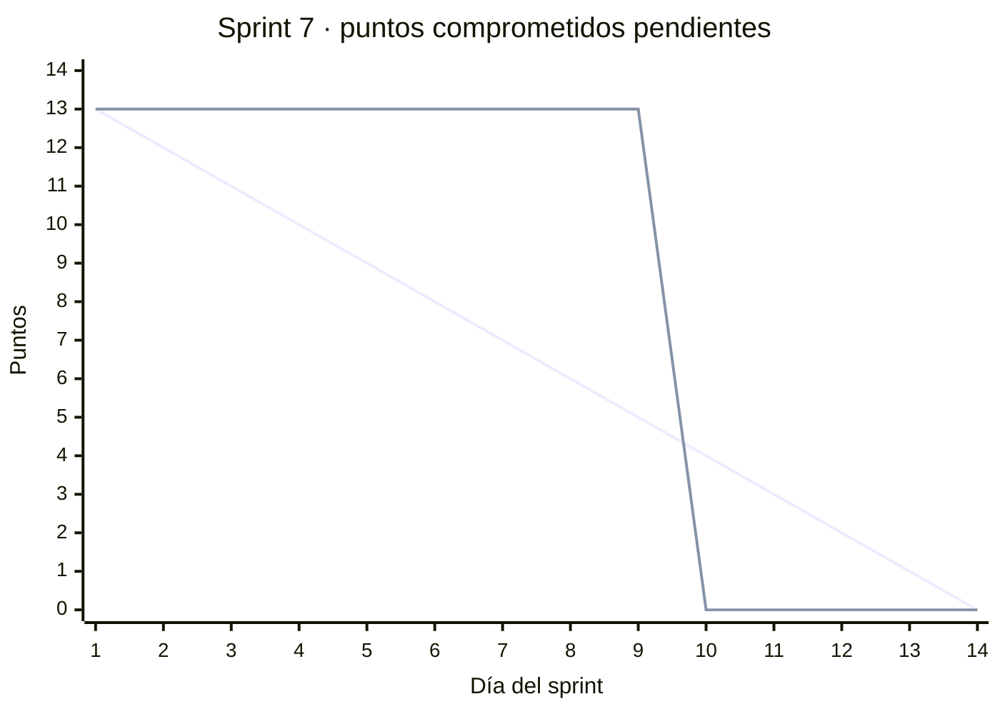

# Sprint 7 — Pago fraccionado, retención y Sistema de Honor

> 27 de octubre al 9 de noviembre de 2026 · Fase 2 · **Sprint en curso**
> Corte de este documento: 8 de noviembre de 2026 (día 13 de 14).

---

## 1. Sprint Planning

**Objetivo del sprint.** Que un jugador confirmado pague su parte del arriendo con Webpay y que pueda
cancelar con la retención por deserción que define el modelo de negocio.

| Dato | Valor |
|---|---|
| Duración | 14 días (27 de octubre – 9 de noviembre) |
| Equipo | Lukas Guerrero, desarrollador único |
| Compromiso | 13 puntos de historia (HU-08 y HU-09) y KAN-23 |
| Alcance agregado durante el sprint | KAN-29 (Expo SDK 58 para ver la app en iPhone y Android), DEF-05 y, el 8 de noviembre, HU-02, HU-06 y HU-07 adelantadas del Sprint 8 (15 puntos) y KAN-30 |

## 2. Sprint Backlog

| Issue | Tipo | Título | Prioridad | Puntos | Estado al 8-nov |
|---|---|---|---|---|---|
| [KAN-14](https://lukasguerrerokancha.atlassian.net/browse/KAN-14) | Historia | HU-08 — Reserva con pago fraccionado | Must | 8 | Listo · PR #10 a `develop` |
| [KAN-15](https://lukasguerrerokancha.atlassian.net/browse/KAN-15) | Historia | HU-09 — Retención por deserción | Should | 5 | Listo · PR #10 a `develop` |
| [KAN-29](https://lukasguerrerokancha.atlassian.net/browse/KAN-29) | Tarea | Actualizar la app a Expo SDK 58 para iPhone y Android | — | — | En curso · PR #7 en `develop`; falta probarla en un iPhone real |
| [KAN-12](https://lukasguerrerokancha.atlassian.net/browse/KAN-12) | Historia | HU-06 — Calificar compañeros post-partido | Must | 5 | Listo · PR #11 a `develop` (adelantada del Sprint 8) |
| [KAN-13](https://lukasguerrerokancha.atlassian.net/browse/KAN-13) | Historia | HU-07 — Cálculo automático de puntaje de honor | Should | 5 | Listo · PR #11 a `develop` (adelantada del Sprint 8) |
| [KAN-8](https://lukasguerrerokancha.atlassian.net/browse/KAN-8) | Historia | HU-02 — Perfil tipo carta de jugador | Should | 5 | Listo · PR #12 a `develop` (adelantada del Sprint 8) |
| [KAN-30](https://lukasguerrerokancha.atlassian.net/browse/KAN-30) | Tarea | Registrar asistencia al terminar el partido | — | — | En revisión · PR a `develop` con CI |
| [KAN-23](https://lukasguerrerokancha.atlassian.net/browse/KAN-23) | Tarea | Documentación de la Fase 2 | — | — | En revisión · actualizada en el mismo PR que KAN-30 |
| [KAN-16](https://lukasguerrerokancha.atlassian.net/browse/KAN-16) | Historia | HU-10 — Notificación de cupo disponible | Could | 3 | Fuera de alcance desde el 8-nov |

Además, el 5 de noviembre se cerró KAN-11 (HU-05, 3 puntos), que venía abierta del Sprint 6.

Desglose técnico:

| Historia | Backend | App |
|---|---|---|
| HU-08 | `POST /payments/:id/init`, página que envía el token a Webpay y `/payments/return` (GET y POST) con `commit` una sola vez · pago fallido o anulado libera el cupo con bloqueo de fila | Botón "Pagar mi parte" con el total y el comprobante con la orden de compra |
| HU-09 | `DELETE /participations/:id` con reembolso por Transbank: 100 % con 12 h o más, 50 % retenido con menos | Botón "Cancelar mi cupo" con la confirmación que muestra cuánto se devuelve |
| HU-06 | `POST /matches/:id/ratings` y `GET …/pending` · ventana de 48 h · `UNIQUE` contra la doble calificación · `CHECK` 1 a 5 (DEF-02) | Pantalla "Calificar compañeros" y sección en "Mis partidos" |
| HU-07 | Honor recalculado en la misma transacción que la reseña, con la fila del calificado bloqueada | El puntaje se actualiza al instante en la carta |
| HU-02 | `GET /users/:id` sin correo | Carta de jugador pública al tocar a un participante |
| KAN-30 | `PATCH /participations/:id/attendance` · columna `attended` · suma `matchesPlayed` | Botones "Asistió" / "No vino" para el organizador |

## 3. Scrumboard

Estado del tablero al 8 de noviembre:

| Por hacer | En curso | En revisión | Listo |
|---|---|---|---|
| — | KAN-29 · Expo SDK 58 | KAN-30 · Asistencia | KAN-14 · HU-08 |
| | | KAN-23 · Documentación Fase 2 | KAN-15 · HU-09 |
| | | | KAN-12 · HU-06 |
| | | | KAN-13 · HU-07 |
| | | | KAN-8 · HU-02 |

## 4. Burndown Chart

Puntos comprometidos pendientes por día (el ideal es la primera línea y el real la segunda):

Los 13 puntos comprometidos se cerraron juntos el día 10 (5 de noviembre), con el merge del PR #10.
El día 13 (8 de noviembre) se agregaron y terminaron los 15 puntos de HU-02, HU-06 y HU-07, que
estaban planificados para el Sprint 8. Puntos terminados en el sprint: 31 (13 comprometidos, 3 de
HU-05 arrastrados del Sprint 6 y 15 adelantados).

## 5. Daily Meeting

| Fecha | Qué hice | Qué haré | Impedimentos |
|---|---|---|---|
| 27 oct – 4 nov | Sin avance registrado en el repositorio ni en Jira | — | IMP-11 |
| 5 nov | Corrección del mapa en la sala de clases (DEF-05, PR #6). App a Expo SDK 58 para iPhone y Android (KAN-29, PR #7). HU-08 con Webpay Plus (PR #8) y HU-09 con reembolso (PR #9), integradas a `develop` en el PR #10 con el CI en verde. Pago y reembolso reales en Integración con la tarjeta de prueba. KAN-11 (HU-05) a *Listo* | Probar la app en el iPhone. Seguir con el Sistema de Honor | Los PRs encadenados se integraron en ramas intermedias y hubo que unirlos en el PR #10 |
| 6–7 nov | Sin avance registrado | — | IMP-11 |
| 8 nov | HU-06 y HU-07 (PR #11) y HU-02 (PR #12) a `develop`, con 131 pruebas del backend y 19 de la app. Análisis de cierre: se detectó que nada sumaba partidos jugados (DEF-06) y se creó KAN-30; `npm audit fix` en el backend (S-11); HU-10 fuera de alcance; documentación al día | Merge del PR de KAN-30 y la documentación. Llevar `develop` a `main` y publicar `v0.7.0`. Cerrar los sprints en Jira | `main` recibió HU-06 y HU-07 directo desde su rama (PR #13), sin HU-02 (IMP-12) |

## 6. Registro de impedimentos

| ID | Impedimento | Efecto | Estado |
|---|---|---|---|
| IMP-11 | Del 27 de octubre al 4 de noviembre, y el 6 y 7 de noviembre, no hubo avance registrado | El trabajo del sprint se concentró en dos días (5 y 8 de noviembre) | Abierto |
| IMP-01 | El Sprint 2 sigue activo en Jira y los sprints 3 a 7 nunca se iniciaron | Sin burndown automático de Jira; los gráficos se hacen a mano | Abierto: cerrar los sprints desde el tablero |
| IMP-12 | El PR #13 llevó a `main` la rama de calificaciones directamente, sin pasar por `develop` | `main` tiene HU-06 y HU-07 pero no HU-02 ni KAN-30 | Abierto: PR de `develop` a `main` |

## 7. Release

Pendiente. Al llevar `develop` a `main` se publica
`v0.7.0 — Sprint 7: pago, retención, calificación, honor, carta de jugador y asistencia`.

## 8. Sprint Review

Borrador al 8 de noviembre; se confirma al cierre, el 9.

| Comprometido | Resultado |
|---|---|
| HU-08 — Reserva con pago fraccionado (8 pts) | Terminada · pago real en Integración (`evidencias/sprint-07/01-comprobante-webpay-HU08.jpg`) |
| HU-09 — Retención por deserción (5 pts) | Terminada · reembolso real en Integración (`evidencias/sprint-07/02-reembolso-transbank-HU09.txt`) |
| KAN-23 — Documentación de la Fase 2 | Al día: arquitectura, modelo de datos, UML, plan de pruebas y documentos de sprint |
| Adelantadas: HU-02, HU-06 y HU-07 (15 pts) | Terminadas · evidencia `evidencias/sprint-07/03` a `07` |
| KAN-30 — Asistencia | Terminada, en revisión · `evidencias/sprint-07/08-asistencia-KAN30.jpg` |

**Velocidad del sprint: 13 de 13 puntos comprometidos y 31 terminados en total.** Con esto, las nueve
historias del MVP (47 puntos) están terminadas. Pruebas: 138 del backend (76 unitarias y 62 de
integración) y 19 de la app; cobertura de `services/` del 98 %.

## 9. Sprint Retrospective

Borrador al 8 de noviembre; se confirma al cierre, el 9.

| Qué funcionó | Qué no funcionó | Acción |
|---|---|---|
| Las funciones de cálculo de pagos y honor ya estaban probadas desde el Sprint 3: integrar Webpay y las reseñas fue rápido | Once de los catorce días sin avance registrado (IMP-11) | Reservar bloques fijos de trabajo durante la práctica y registrar el motivo cuando no se avanza |
| El análisis de cierre encontró una regla de negocio sin historia (DEF-06) antes de la entrega | Los PRs encadenados terminaron integrados en ramas intermedias, y uno llegó a `main` sin pasar por `develop` | Abrir cada PR siempre contra `develop` y llevar `develop` a `main` solo al cerrar el sprint |
| Probar en la app real con Docker, no solo con pruebas automáticas, confirmó cada historia | Los sprints de Jira siguen sin iniciarse ni cerrarse (IMP-01) | Cerrar los sprints 2 a 7 en Jira e iniciar el 8 con su meta |

---

*Kancha · Portafolio de Título · Lukas Guerrero*
