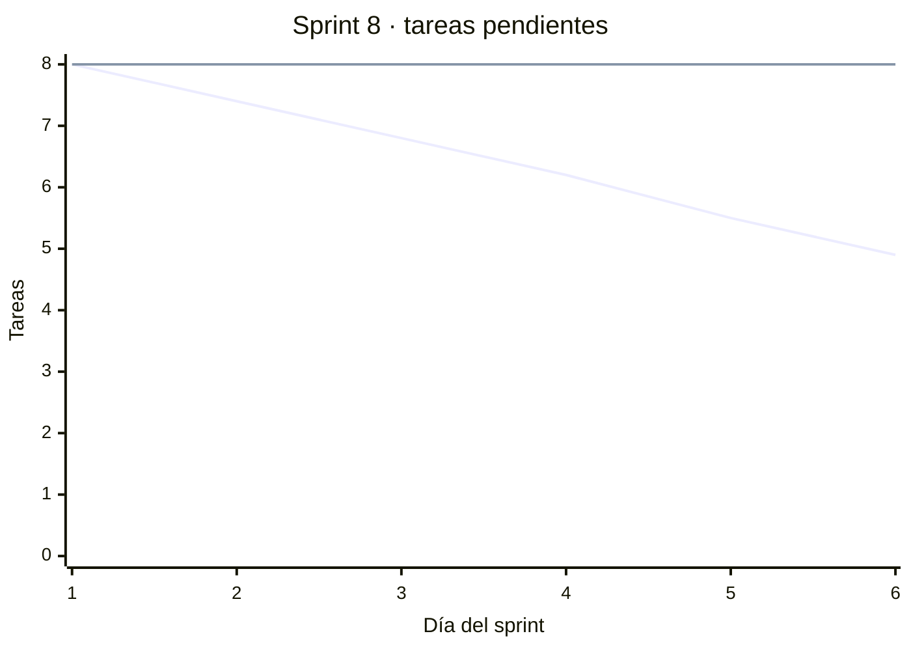

# Sprint 8 — Dejar el MVP listo para la defensa

> 10 al 23 de noviembre de 2026 · Fase 3 · **Sprint en curso**
> Corte de este documento: 15 de noviembre de 2026 (día 6 de 14).

---

## 1. Sprint Planning

**Objetivo del sprint.** Que el MVP esté listo para defenderse: revisado de punta a punta, corregido,
con mejor presentación visual, desplegado como respaldo y con sus pruebas de rendimiento ejecutadas.

Las nueve historias del MVP se terminaron en el Sprint 7, así que este sprint no compromete puntos
de historia. El trabajo se mide en tareas.

| Dato | Valor |
|---|---|
| Duración | 14 días (10 – 23 de noviembre) |
| Equipo | Lukas Guerrero, desarrollador único |
| Compromiso | 8 tareas: auditoría y correcciones, rechazo de postulaciones, rediseño visual, despliegue, rendimiento, releases, prueba en teléfonos y documentación |

El 15 de noviembre se acordó el orden de cierre, en tres etapas: (1) terminar de revisar y dejar todo
implementado, (2) rediseñar la parte visual y (3) terminar la documentación y estudiar cómo se
construyó cada validación para defenderla.

## 2. Sprint Backlog

| Issue | Tipo | Título | Estado al 15-nov |
|---|---|---|---|
| [KAN-31](https://lukasguerrerokancha.atlassian.net/browse/KAN-31) | Tarea | Correcciones de la auditoría de cierre | En revisión · PR #15 a `develop` |
| [KAN-32](https://lukasguerrerokancha.atlassian.net/browse/KAN-32) | Tarea | El organizador puede rechazar una postulación | En revisión · PR #15 a `develop` |
| [KAN-33](https://lukasguerrerokancha.atlassian.net/browse/KAN-33) | Tarea | Rediseño visual de la app (etapa 2) | Por hacer |
| [KAN-34](https://lukasguerrerokancha.atlassian.net/browse/KAN-34) | Tarea | Desplegar la demo pública en Render + Supabase | Por hacer · requiere crear las cuentas |
| [KAN-35](https://lukasguerrerokancha.atlassian.net/browse/KAN-35) | Tarea | Pruebas de rendimiento con k6 (R-01 a R-05) | Por hacer |
| [KAN-36](https://lukasguerrerokancha.atlassian.net/browse/KAN-36) | Tarea | Llevar `develop` a `main` y publicar los releases | Por hacer |
| [KAN-29](https://lukasguerrerokancha.atlassian.net/browse/KAN-29) | Tarea | Expo SDK 58: probar en un iPhone y un Android reales | En curso · viene del Sprint 7 |
| [KAN-23](https://lukasguerrerokancha.atlassian.net/browse/KAN-23) | Tarea | Documentación de la Fase 2 | En curso · faltan los documentos de la entrega |

Desglose técnico de lo hecho:

| Tarea | Backend | App |
|---|---|---|
| KAN-31 · pagos | Cancelar cierra el pago iniciado; el pago aprobado se registra con el partido bloqueado o se devuelve; reembolso al final de la transacción; consulta de estado en Transbank; id de sesión aleatorio; no se vuelve a postular tras cancelar un cupo pagado | Quien canceló un cupo pagado ya no ve el botón de postular |
| KAN-31 · seguridad y despliegue | Límite de intentos (S-12); `DEMO_MODE`; migraciones en el arranque de la imagen; `CHECK` de cupos y montos; apagado ordenado | — |
| KAN-31 · integración | Filtro de nivel ya aceptado por la API | Asistencia alcanzable desde "Mis partidos"; caché por cuenta; refresco automático; rótulo de cada estado; filtro de nivel en el mapa |
| KAN-31 · CI | Cobertura con umbral; base en hora de Chile; arranque real de `docker compose` | Las pruebas Jest corren en el CI |
| KAN-32 | `PATCH /participations/:id/reject` con el bloqueo de la aprobación; estado `REJECTED` | Botón "Rechazar" y mensaje al jugador |

## 3. Scrumboard

Estado del tablero al 15 de noviembre:

| Por hacer | En curso | En revisión | Listo |
|---|---|---|---|
| KAN-33 · Rediseño visual | KAN-29 · Prueba en teléfonos | KAN-31 · Auditoría | — |
| KAN-34 · Despliegue | KAN-23 · Documentación | KAN-32 · Rechazar | |
| KAN-35 · Rendimiento | | | |
| KAN-36 · Releases | | | |

## 4. Burndown Chart

Tareas pendientes por día, hasta el corte (el ideal es la primera línea y el real la segunda):

La línea real sigue en 8 porque una tarea solo baja cuando cumple la Definición de Terminado, y eso
incluye el merge con el CI en verde. KAN-31 y KAN-32 están terminadas y en revisión en el PR #15: al
integrarse, la línea baja a 6.

## 5. Daily Meeting

| Fecha | Qué hice | Qué haré | Impedimentos |
|---|---|---|---|
| 10–13 nov | Sin avance registrado en el repositorio ni en Jira | — | IMP-11 |
| 14 nov | Revisión del avance: 138 pruebas del backend y 19 de la app en verde, build y tipos limpios. Medición de la búsqueda por radio: 100 peticiones, mediana 4 ms y p95 5 ms (12 partidos, un usuario). Auditoría de cierre: seis revisiones independientes y escépticos que intentan refutar cada hallazgo | Revisar los hallazgos y corregir | La sesión se interrumpió antes de terminar la verificación (IMP-13) |
| 15 nov | Se recuperó el resultado: 71 hallazgos. Los 14 que quedaron sin escéptico se comprobaron a mano. Tres decisiones de negocio: el honor usa tres señales, no se vuelve a postular tras cancelar un cupo pagado, y se agrega "Rechazar". Correcciones de KAN-31 y KAN-32 con 167 pruebas del backend y 26 de la app. Informe de auditoría y documentación al día. PR #15 | Merge del PR #15. Empezar el rediseño visual (KAN-33) | `main` sigue atrás de `develop` (IMP-12) |

## 6. Registro de impedimentos

| ID | Impedimento | Efecto | Estado |
|---|---|---|---|
| IMP-11 | Del 10 al 13 de noviembre no hubo avance registrado | El trabajo del sprint empezó el día 5 | Abierto |
| IMP-01 | El Sprint 2 sigue activo en Jira y los sprints 3 a 8 nunca se iniciaron | Sin burndown automático de Jira; los gráficos se hacen a mano | Abierto: cerrar los sprints desde el tablero |
| IMP-12 | `main` no tiene HU-02, KAN-30, KAN-31 ni KAN-32, y solo existe el tag `v0.3.0` | La rama de producción no refleja el producto | Abierto: KAN-36 |
| IMP-13 | La auditoría se interrumpió antes de verificar dos de sus seis dimensiones | 14 hallazgos quedaron sin escéptico | Cerrado el 15-nov: se comprobaron a mano contra el código y en la app |
| IMP-14 | Al limitar el puerto de la base a `127.0.0.1`, cada conexión nueva tardaba 2 s: en Windows `localhost` se resuelve primero por IPv6 | Una prueba de concurrencia empezó a fallar | Cerrado el 15-nov: el puerto se publica en los dos loopback |

## 7. Release

Pendiente. Al integrar el PR #15 y llevar `develop` a `main` (KAN-36) se publican los releases
atrasados y `v0.8.0 — Sprint 8: auditoría de cierre y rechazo de postulaciones`.

## 8. Sprint Review

Se completa al cierre del sprint, el 23 de noviembre. Avance al corte:

| Comprometido | Resultado al 15-nov |
|---|---|
| KAN-31 — Correcciones de la auditoría | Terminada, en revisión · 45 de 71 hallazgos corregidos; informe en [`05-auditoria-cierre.md`](../05-auditoria-cierre.md) |
| KAN-32 — Rechazar postulación | Terminada, en revisión · evidencia en `evidencias/sprint-08/03-aprobar-o-rechazar-KAN32.jpg` |
| KAN-33 a KAN-36, KAN-29 y KAN-23 | Sin terminar |

## 9. Sprint Retrospective

Se completa al cierre del sprint, el 23 de noviembre.

---

*Kancha · Portafolio de Título · Lukas Guerrero*
