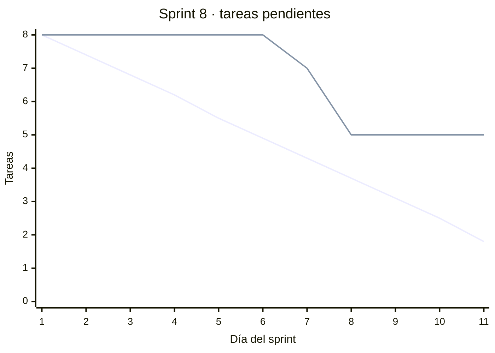

# Sprint 8 — Dejar el MVP listo para la defensa

> 10 al 23 de noviembre de 2026 · Fase 3 · **Sprint en curso**
> Corte de este documento: 20 de noviembre de 2026 (día 11 de 14).

---

## 1. Sprint Planning

**Objetivo del sprint.** Que el MVP esté listo para defenderse: revisado de punta a punta, corregido,
con mejor presentación visual, desplegado como respaldo y con sus pruebas de rendimiento ejecutadas.

Las nueve historias del MVP se terminaron en el Sprint 7, así que este sprint no compromete puntos
de historia. El trabajo se mide en tareas.

| Dato | Valor |
|---|---|
| Duración | 14 días (10 – 23 de noviembre) |
| Equipo | Lukas Guerrero, desarrollador único |
| Compromiso | 8 tareas: auditoría y correcciones, rechazo de postulaciones, rediseño visual, despliegue, rendimiento, releases, prueba en teléfonos y documentación |
| Alcance agregado durante el sprint | KAN-37, el botón "Falta uno", y KAN-38, el límite real de la comuna con canchas existentes (16 de noviembre) |

El 15 de noviembre se acordó el orden de cierre, en tres etapas: (1) terminar de revisar y dejar todo
implementado, (2) rediseñar la parte visual y (3) terminar la documentación y estudiar cómo se
construyó cada validación para defenderla.

El 16 de noviembre se agregó KAN-37, el botón "Falta uno": faltaba la función que da nombre al
problema que Kancha resuelve. Ese día también se invirtió el orden de las dos últimas etapas: primero
se termina la documentación y después se hace el rediseño visual.

Esa misma noche el autor pidió hacer el rediseño de inmediato (KAN-33), con dos skills de diseño y la
presentación de Fase 1 como referencia, y sumó KAN-38. La documentación queda como última etapa.

## 2. Sprint Backlog

| Issue | Tipo | Título | Estado al 20-nov |
|---|---|---|---|
| [KAN-31](https://lukasguerrerokancha.atlassian.net/browse/KAN-31) | Tarea | Correcciones de la auditoría de cierre | Listo · PR #15 integrado a `develop` el 16-nov |
| [KAN-32](https://lukasguerrerokancha.atlassian.net/browse/KAN-32) | Tarea | El organizador puede rechazar una postulación | Listo · PR #15 integrado a `develop` el 16-nov |
| [KAN-37](https://lukasguerrerokancha.atlassian.net/browse/KAN-37) | Tarea | Botón "Falta uno": filtrar en el mapa los partidos urgentes | Listo · PR #16 integrado a `develop` el 17-nov · agregada el 16-nov |
| [KAN-38](https://lukasguerrerokancha.atlassian.net/browse/KAN-38) | Tarea | Límite real de La Florida, canchas existentes al publicar y dirección automática | Listo · PR #18 integrado a `develop` el 17-nov · agregada el 16-nov · evidencia `evidencias/sprint-08/10` a `12`, `15` y `16` |
| [KAN-33](https://lukasguerrerokancha.atlassian.net/browse/KAN-33) | Tarea | Rediseño visual de la app | Listo · PR #17 y PR #18 integrados a `develop` el 17-nov · adelantado el 16-nov por decisión del autor · evidencia `evidencias/sprint-08/07` a `09`, `13` y `14` |
| [KAN-34](https://lukasguerrerokancha.atlassian.net/browse/KAN-34) | Tarea | Desplegar la demo pública en Render + Supabase | Por hacer · requiere crear las cuentas |
| [KAN-35](https://lukasguerrerokancha.atlassian.net/browse/KAN-35) | Tarea | Pruebas de rendimiento con k6 (R-01 a R-05) | Por hacer |
| [KAN-36](https://lukasguerrerokancha.atlassian.net/browse/KAN-36) | Tarea | Llevar `develop` a `main` y publicar los releases | En curso · PR #19 de `develop` a `main` (20-nov) |
| [KAN-29](https://lukasguerrerokancha.atlassian.net/browse/KAN-29) | Tarea | Expo SDK 58: probar en un iPhone y un Android reales | En curso · viene del Sprint 7 |
| [KAN-23](https://lukasguerrerokancha.atlassian.net/browse/KAN-23) | Tarea | Documentación de la Fase 2 | En curso · faltan los documentos de la entrega |

Desglose técnico de lo hecho:

| Tarea | Backend | App |
|---|---|---|
| KAN-31 · pagos | Cancelar cierra el pago iniciado; el pago aprobado se registra con el partido bloqueado o se devuelve; reembolso al final de la transacción; consulta de estado en Transbank; id de sesión aleatorio; no se vuelve a postular tras cancelar un cupo pagado | Quien canceló un cupo pagado ya no ve el botón de postular |
| KAN-31 · seguridad y despliegue | Límite de intentos (S-12); `DEMO_MODE`; migraciones en el arranque de la imagen; `CHECK` de cupos y montos; apagado ordenado | — |
| KAN-31 · integración | Filtro de nivel ya aceptado por la API | Asistencia alcanzable desde "Mis partidos"; caché por cuenta; refresco automático; rótulo de cada estado; filtro de nivel en el mapa |
| KAN-31 · CI | Cobertura con umbral; base en hora de Chile; arranque real de `docker compose` | Las pruebas Jest corren en el CI |
| KAN-32 | `PATCH /participations/:id/reject` con el bloqueo de la aprobación; estado `REJECTED` | Botón "Rechazar" y mensaje al jugador |
| KAN-37 | `GET /matches/nearby?urgent=true`: solo partidos a los que les falta exactamente 1 jugador y que empiezan dentro de `URGENT_WINDOW_HOURS` (2 h) · tres partidos urgentes en los datos de demostración, uno por deporte | Botón "Falta uno" justo sobre la barra de partidos del mapa, con su contador y su mensaje cuando no hay urgentes |
| KAN-33 | — | Isotipo de Kancha, Anton en títulos y números clave, hora grande y "Falta 1" en la carta de partido, carta de jugador como carta coleccionable, fotografía por deporte (portada del partido, carta de jugador y entrada) y transiciones entre pantallas |
| KAN-38 | El seed ubica los 15 partidos dentro de la comuna · `/users/me` responde 401 si el usuario de la sesión ya no existe | Límite real de La Florida en el mapa (OpenStreetMap), lista de canchas existentes al publicar, dirección automática al marcar un punto (Nominatim) y rechazo de puntos fuera de la comuna |

## 3. Scrumboard

Estado del tablero al 20 de noviembre:

| Por hacer | En curso | Listo |
|---|---|---|
| KAN-34 · Despliegue | KAN-29 · Prueba en teléfonos | KAN-31 · Auditoría |
| KAN-35 · Rendimiento | KAN-23 · Documentación | KAN-32 · Rechazar |
| | KAN-36 · Releases | KAN-37 · Falta uno |
| | | KAN-33 · Rediseño visual |
| | | KAN-38 · Comuna y canchas |

## 4. Burndown Chart

Tareas pendientes por día, hasta el corte (el ideal es la primera línea y el real la segunda):

La línea real se mantuvo en 8 hasta el día 6 porque una tarea solo baja cuando cumple la Definición
de Terminado, y eso incluye el merge con el CI en verde. El día 7 (16 de noviembre) se integró el
PR #15: KAN-31 y KAN-32 pasaron a Listo y quedaron 6. Ese mismo día se agregó KAN-37, que deja 7
tareas pendientes hasta que su PR se integre. El día 8 (17 de noviembre) se sumó KAN-38 y, esa misma
noche, se integraron los PR #16, #17 y #18: KAN-37, KAN-33 y KAN-38 pasaron a Listo y quedaron 5.
Siguen 5 al día 11: KAN-36 está en curso y las otras cuatro dependen de las cuentas de la nube, de los
teléfonos y de los formatos de la entrega.

## 5. Daily Meeting

| Fecha | Qué hice | Qué haré | Impedimentos |
|---|---|---|---|
| 10–13 nov | Sin avance registrado en el repositorio ni en Jira | — | IMP-11 |
| 14 nov | Revisión del avance: 138 pruebas del backend y 19 de la app en verde, build y tipos limpios. Medición de la búsqueda por radio: 100 peticiones, mediana 4 ms y p95 5 ms (12 partidos, un usuario). Auditoría de cierre: seis revisiones independientes y escépticos que intentan refutar cada hallazgo | Revisar los hallazgos y corregir | La sesión se interrumpió antes de terminar la verificación (IMP-13) |
| 15 nov | Se recuperó el resultado: 71 hallazgos. Los 14 que quedaron sin escéptico se comprobaron a mano. Tres decisiones de negocio: el honor usa tres señales, no se vuelve a postular tras cancelar un cupo pagado, y se agrega "Rechazar". Correcciones de KAN-31 y KAN-32 con 167 pruebas del backend y 26 de la app. Informe de auditoría y documentación al día. PR #15 | Merge del PR #15. Empezar el rediseño visual (KAN-33) | `main` sigue atrás de `develop` (IMP-12) |
| 16 nov | Merge del PR #15: KAN-31 y KAN-32 a *Listo*. Botón "Falta uno" (KAN-37): la API decide qué es urgente (falta 1 jugador y empieza en 2 h o menos) y el mapa lo filtra; 172 pruebas del backend y 27 de la app. Verificado en la app entrando desde el login, en ancho de celular y de escritorio. PR #16 | Merge del PR #16. Terminar la documentación (KAN-23) y después el rediseño visual (KAN-33) | Docker Desktop no arrancaba (IMP-15) |
| 17 nov | Noche del 16 al 17. Rediseño visual (KAN-33, PR #17). Límite real de la comuna, canchas existentes y dirección automática (KAN-38, PR #18), con la carta de jugador nueva, fotos por deporte y transiciones. Revisión de incidencias: la demo caía fuera de la comuna (DEF-20), sesión sin usuario tras regenerar los datos (DEF-21), dirección que no habría funcionado en teléfonos (DEF-22) y estado de los chips para lectores de pantalla en la web. 173 pruebas del backend y 31 de la app; publicar un partido eligiendo una cancha, verificado en la app de punta a punta | Merge de los PR #16, #17 y #18, en ese orden. Documentos de la entrega (KAN-23) | Tres PR encadenados sin integrar (IMP-16) |
| 18–19 nov | Sin avance registrado en el repositorio | — | — |
| 20 nov | Lista de todo lo pendiente para el cierre. Épica KAN-3 cerrada en Jira (sus tres hijos estaban en Listo). PR #19 de `develop` a `main` con el CI en verde (KAN-36). `DESARROLLO.md` §8 corregido: Supabase por el Session pooler, regla de reescritura de la web y `NODE_VERSION` | Merge del PR #19 y releases. Crear las cuentas de Supabase y Render (KAN-34) | Las tareas que quedan dependen de cuentas, teléfonos y formatos que solo tiene el autor |

## 6. Registro de impedimentos

| ID | Impedimento | Efecto | Estado |
|---|---|---|---|
| IMP-11 | Del 10 al 13 de noviembre no hubo avance registrado | El trabajo del sprint empezó el día 5 | Abierto |
| IMP-01 | El Sprint 2 sigue activo en Jira y los sprints 3 a 8 nunca se iniciaron | Sin burndown automático de Jira; los gráficos se hacen a mano | Abierto: cerrar los sprints desde el tablero |
| IMP-12 | `main` no tiene HU-02, KAN-30, KAN-31 ni KAN-32, y solo existe el tag `v0.3.0` | La rama de producción no refleja el producto | Abierto: KAN-36 |
| IMP-13 | La auditoría se interrumpió antes de verificar dos de sus seis dimensiones | 14 hallazgos quedaron sin escéptico | Cerrado el 15-nov: se comprobaron a mano contra el código y en la app |
| IMP-14 | Al limitar el puerto de la base a `127.0.0.1`, cada conexión nueva tardaba 2 s: en Windows `localhost` se resuelve primero por IPv6 | Una prueba de concurrencia empezó a fallar | Cerrado el 15-nov: el puerto se publica en los dos loopback |
| IMP-15 | Docker Desktop no arrancaba: quedaron sockets huérfanos de un cierre anterior y el motor no podía renombrarlos | No se pudieron correr las pruebas de integración ni la app en Docker hasta resolverlo | Cerrado el 16-nov: con Docker detenido se apartaron las carpetas `Docker\run` y `docker-secrets-engine`; el motor levantó sin perder imágenes ni volúmenes |
| IMP-16 | Tres PR abiertos a la vez y encadenados (#16, #17 y #18): cada uno parte de la rama del anterior | Hasta integrarlos en orden, `develop` no tiene el botón "Falta uno", el rediseño ni el límite de la comuna | Cerrado el 17-nov: se integraron en orden, con el CI en verde |

## 7. Release

En curso. El PR #19 lleva `develop` a `main` (KAN-36): el merge simulado con `git merge-tree` queda
idéntico a `develop`. Al integrarse se publican los releases atrasados `v0.6.0` y `v0.7.0`, y
`v0.8.0 — Sprint 8: auditoría de cierre, rechazo de postulaciones, "Falta uno", rediseño y comuna`.

## 8. Sprint Review

Se completa al cierre del sprint, el 23 de noviembre. Avance al corte:

| Comprometido | Resultado al 20-nov |
|---|---|
| KAN-31 — Correcciones de la auditoría | Terminada e integrada (PR #15) · 45 de 71 hallazgos corregidos; informe en [`05-auditoria-cierre.md`](../05-auditoria-cierre.md) |
| KAN-32 — Rechazar postulación | Terminada e integrada (PR #15) · evidencia en `evidencias/sprint-08/03-aprobar-o-rechazar-KAN32.jpg` |
| KAN-37 — Botón "Falta uno" (agregada el 16-nov) | Terminada e integrada (PR #16) · evidencia en `evidencias/sprint-08/04-falta-uno-activo-KAN37.png`, `05` y `06` |
| KAN-33 — Rediseño visual | Terminada e integrada (PR #17 y PR #18) · evidencia en `evidencias/sprint-08/07` a `09`, `13` y `14` |
| KAN-38 — Comuna, canchas y dirección (agregada el 16-nov) | Terminada e integrada (PR #18) · evidencia en `evidencias/sprint-08/10` a `12`, `15` y `16` |
| KAN-34 a KAN-36, KAN-29 y KAN-23 | Sin terminar |

## 9. Sprint Retrospective

Se completa al cierre del sprint, el 23 de noviembre.

---

*Kancha · Portafolio de Título · Lukas Guerrero*
